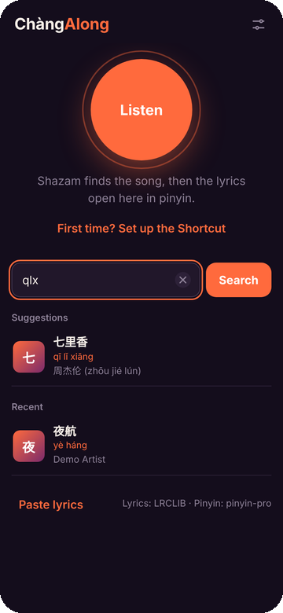

<p align="center"></p>

# ChàngAlong · 唱 Along

Sing Chinese songs at karaoke without reading Chinese. Lyrics show pinyin under every character and highlight in time with the music.

**[Open the app →](https://notclement.github.io/changalong/)**

| Search | Sing | Song info |
| :---: | :---: | :---: |
|  |  |  |

## Features

- Pinyin with tone marks under each character; Cantonese (jyutping) per song
- Lyrics in time with the music: tap the line being sung once, then it scrolls by itself
- Duet colours (Him / Her / Both) and a 3-2-1 countdown after instrumentals
- Search by title, part of a title, or pinyin initials (`nnmat` → 你那么爱她)
- Short AI summary of what a song is about, and one-tap lyric translation
- Works offline for songs you've opened

## Set up Listen (once)

Listen uses the iPhone's built-in Shazam through a Shortcut.

1. Open the app in Safari and tap **First time? Set up the Shortcut → Copy prompt** (or copy it below).
2. Open the **Shortcuts** app and create a new shortcut with its AI builder, then paste the prompt.
3. Check the shortcut is named exactly **ChangAlong**.
4. Optional: Settings → Accessibility → Touch → **Back Tap** → Double Tap → ChangAlong.

```text
Create a shortcut named "ChangAlong" that does this:
1. Use the Recognize Music (Shazam) action to identify the song playing around me.
2. If no song is recognised, show the alert "No song found. Try again closer to the speaker." and stop.
3. Get the Title of the Shazam Media and URL-encode it.
4. Get the Artist of the same Shazam Media and URL-encode it.
5. Build this URL, inserting the encoded values: https://notclement.github.io/changalong/?title=[encoded title]&artist=[encoded artist]
6. Open that URL in Safari.
```

No AI builder? Add these actions by hand: Recognize Music → URL Encode (Shazam Media → Title) → Text `https://notclement.github.io/changalong/?title=` + URL Encoded Text → Open URLs.

## How to use

1. Tap **Listen** (or double-tap the back of the phone). Shazam finds the song and the lyrics open.
2. Tap the line being sung right now. The lyrics then scroll in time.
3. Lyrics late or early? Tap **Behind** / **Ahead**, or tap the current line again.
4. No Shazam? Search by title or pinyin initials instead.

## Built with

[LRCLIB](https://lrclib.net) (lyrics) · [pinyin-pro](https://github.com/zh-lx/pinyin-pro) · [to-jyutping](https://github.com/CanCLID/to-jyutping) · [OpenCC](https://github.com/BYVoid/OpenCC) dictionaries · [Pollinations](https://pollinations.ai) / Gemini / [Puter](https://puter.com) (AI) · GitHub Pages

Free, no account. Your fixes and recent songs stay on your phone.

## Development

Static files, no build step: `python3 -m http.server`, then open `localhost:8000`.
On each release, bump `VERSION` in `app.js`, the `?v=` numbers in `index.html` and `CACHE` in `sw.js`.
Add songs to `vendor/catalog.js` as `['Title', 'Singer']`, or `['Title', 'Singer', 'y']` for Cantonese.

## Notes

Tested on iPhone 17 Pro Max only. Found a problem or have an idea? [Open an issue](https://github.com/notclement/changalong/issues).
