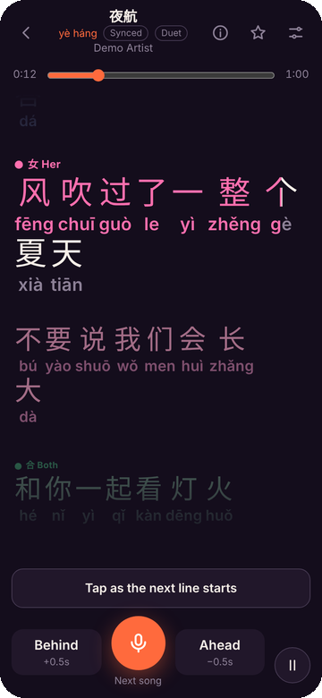
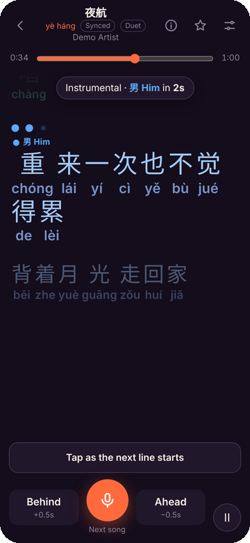
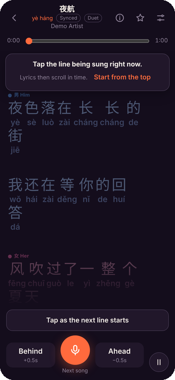
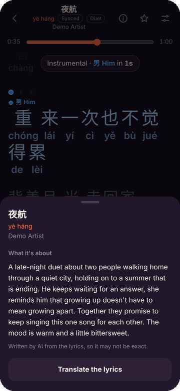
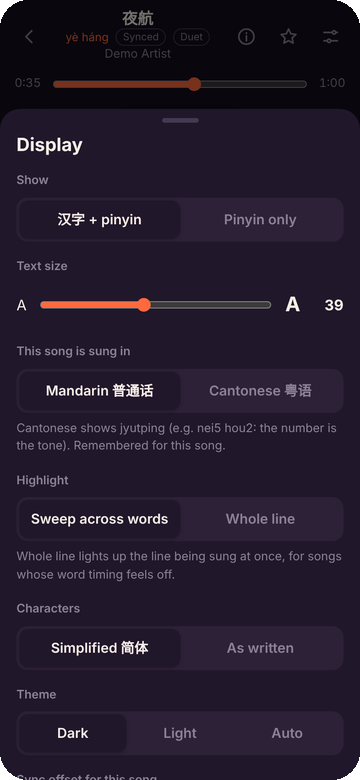
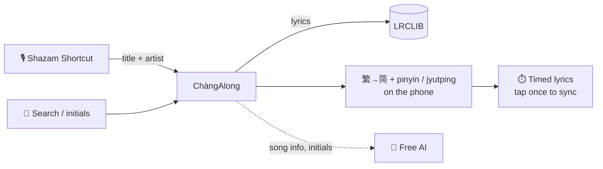

<p align="center">
  
</p>

<h1 align="center">ChàngAlong · 唱 Along</h1>

<p align="center">
  <b>Can't read Chinese? Sing it anyway.</b><br>
  Shazam finds the song, the lyrics appear with pinyin under every character,<br>and they light up in time with the music.
</p>

<p align="center">
  <a href="https://notclement.github.io/changalong/"><b>▶ Open the app</b></a> ·
  <a href="#set-up-listen-once">Set up Listen</a> ·
  <a href="#features">Features</a> ·
  <a href="#how-it-works">How it works</a>
</p>

<p align="center">
  
  
  
  
</p>

---

## Screenshots

| Find a song | Sing along | Duet & countdown |
| :---: | :---: | :---: |
|  |  |  |
| Type a title, part of it, or pinyin initials (`qlx` → 七里香) | Characters on top, pinyin underneath, highlight follows the singer | Him / Her / Both colours, plus a 3-2-1 countdown after breaks |

| Start in sync | Song info | Settings |
| :---: | :---: | :---: |
|  |  |  |
| Tap the line being sung and everything scrolls in time | A short AI summary of what the song is about, and one-tap lyric translation | Pinyin only or with characters, size, Mandarin or Cantonese, theme |

<sub>Screenshots use original demo lyrics written for this app, and a sample summary.</sub>

---

## Features

**Reading**
- 🀄 **Pinyin under every character** with proper tone marks and 一/不 tone changes (`yì qǐ`, `bú yào`)
- 🔤 **Smart readings** for characters with more than one pronunciation (多音字): 长大 → zhǎng dà, 银行 → yín háng
- ✍️ **Fix any reading**: press and hold a syllable and pick the right one; it's remembered for that song
- 繁 **Traditional → Simplified** conversion (can be turned off)
- 🗣️ **Cantonese mode** with jyutping (nei5 hou2) for Cantopop, set per song; about 65 Cantopop classics switch on automatically
- 🌏 **Other languages** (English, Japanese, Korean…) are shown as plain text with the same timing

**Singing**
- ⏱️ **In time with the music**: tap the line being sung once, then it scrolls by itself
- 🎯 **Word-by-word highlight** when the lyrics file has word timing; otherwise paced to the song
- ③②① **Countdown dots** and "next line in 8s" during intros and instrumentals
- 💗 **Duets in colour**: 男 Him blue, 女 Her pink, 合 Both green, with a heads-up before each change
- ↔️ **Behind / Ahead** nudges (0.5 s), saved per song, plus a **pause** button

**Finding songs**
- 🎙️ **Listen** with iPhone's built-in Shazam (via a Shortcut)
- 🔎 **Search** by title, part of a title (`你那么`), or **pinyin initials** (`nnmat` → 你那么爱她)
- 🤖 Initials work for **any well-known song**: a free AI suggests titles, and the app keeps only the ones whose initials really match
- 📚 Built-in list of **~530 KTV favourites** for instant suggestions, plus your recent songs and favourites

**Everything else**
- ℹ️ **Song info**: a short plain-English summary of what the song means (AI), and **Translate the lyrics**
- 🏷️ **Grey tags**: Word synced · Synced · Lyrics only · Duet · Live · 繁→简 · Cantonese ([what they mean](#tags))
- 📴 **Offline**: the app and every song you've opened work without signal
- 📱 Phones, tablets, portrait and landscape; dark and light themes

---

## Set up "Listen" (once)

Listen uses the iPhone's built-in Shazam through a Shortcut named **ChangAlong**.

**Quick way:** in the app tap **First time? Set up the Shortcut → Copy prompt**, and paste it into an AI shortcut builder:

```text
Create a shortcut named "ChangAlong" that does this:
1. Use the Recognize Music (Shazam) action to identify the song playing around me.
2. If no song is recognised, show the alert "No song found. Try again closer to the speaker." and stop.
3. Get the Title of the Shazam Media and URL-encode it.
4. Get the Artist of the same Shazam Media and URL-encode it.
5. Build this URL, inserting the encoded values: https://notclement.github.io/changalong/?title=[encoded title]&artist=[encoded artist]
6. Open that URL in Safari.
```

**By hand:** Recognize Music → URL Encode (*Shazam Media → Title*) → Text `https://notclement.github.io/changalong/?title=` + *URL Encoded Text* → Open URLs.

> 💡 **Tip:** Settings → Accessibility → Touch → **Back Tap** → Double Tap → *ChangAlong*. Then two taps on the back of your phone starts listening.

---

## At the KTV

1. Tap **Listen** (or double-tap the back of the phone). Shazam finds the song and the lyrics open.
2. **Tap the line being sung right now.** From then on the lyrics scroll by themselves.
3. Lyrics a little late or early? **Behind** / **Ahead** (0.5 s each). Way off? Just tap the current line again.
4. Before a night out, open the songs you plan to sing once with signal and ⭐ them, so they work offline.

---

## Tags

| Tag | Meaning |
| --- | --- |
| `Word synced` | Every word is timed, so the highlight follows the real rhythm |
| `Synced` | Each line is timed; inside a line the highlight follows the song's pace |
| `Lyrics only` | No timing: tap **Next line** as you sing |
| `Duet` | Lines are marked 男 / 女 / 合 and colour-coded |
| `Live` `Remix` `Acoustic` `Instrumental` `Cover` | Not the studio version, so timing may differ from the KTV's |
| `繁→简` | Converted from Traditional characters |
| `Cantonese` | Showing jyutping instead of pinyin |
| `No pinyin` `Japanese` `Korean` | Not a Chinese song, shown as plain text |
| `AI match` | Found from your pinyin initials by the AI |

---

## How it works



| Part | What it uses | Cost |
| --- | --- | --- |
| Song recognition | iPhone's built-in Shazam (Shortcuts **Recognize Music**) | Free |
| Lyrics | [LRCLIB](https://lrclib.net) (crowd-sourced, synced lyrics) | Free, no key |
| Pinyin | [pinyin-pro](https://github.com/zh-lx/pinyin-pro), bundled | Free, offline |
| Cantonese | [to-jyutping](https://github.com/CanCLID/to-jyutping), bundled, loaded on demand | Free, offline |
| Traditional → Simplified | Dictionaries from [OpenCC](https://github.com/BYVoid/OpenCC) | Free, offline |
| Song info & initials | [Pollinations](https://pollinations.ai) text API, no key | Free, rate-limited (~1 request / 15 s) |
| Hosting | GitHub Pages | Free |

**Privacy:** no account, no tracking. Your favourites, recent songs, timing fixes and reading fixes stay on your phone. The only things sent anywhere are song names and lyrics excerpts (to LRCLIB and the AI). Audio is handled by Apple's Shazam and never reaches this app.

**Limits worth knowing:** lyrics are crowd-made, so the odd line can be timed a little off; the app can't hear the music once it's running, so a KTV version played faster or slower needs a re-tap; the free AI can be busy for a few seconds.

---

## Development

Plain static files, no build step:

```
index.html             app markup
app.css                styles (dark/light, phone/tablet)
app.js                 everything else
sw.js                  offline cache (network first, cache fallback)
manifest.webmanifest   install as an app
vendor/pinyin-pro.js   pinyin-pro, compiled to one browser file (MIT)
vendor/to-jyutping.js  to-jyutping, compiled to one browser file (BSD-2-Clause)
vendor/t2s.js          Traditional→Simplified from OpenCC dictionaries (Apache-2.0)
vendor/catalog.js      built-in KTV song list (titles and singers only)
docs/                  README images
```

Run locally:

```bash
python3 -m http.server 8765
# open http://localhost:8765
```

On every release, bump `VERSION` in `app.js`, the `?v=` numbers in `index.html` and `CACHE` in `sw.js`, so phones load the new files.

**Adding songs to the built-in list:** add `['Title', 'Singer']` to `vendor/catalog.js` (Simplified Chinese), or `['Title', 'Singer', 'y']` for a Cantonese song.

---

<p align="center"><sub>Made for singing along with friends at KTV 🎤 · Lyrics © their respective owners, fetched live from LRCLIB and never stored in this repository.</sub></p>
